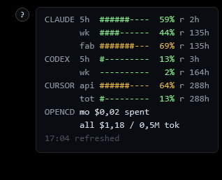

# usage-overlay

A tiny, always-on-top, click-through overlay for Windows and macOS that shows how much
of your AI coding-agent quota you have used. Bars are green under 60%, amber
from 60%, red from 85%, with a countdown to each window reset. On fetch
failures it keeps the last good numbers (shown amber) and retries. Open the
built-in legend with `?` on Windows or the menu-bar menu on macOS.

> **macOS?** A native Swift/AppKit port lives in [`macos/`](macos/README.md).
> Run `./macos/install.sh` to build, install and launch it. Requires macOS 13+
> and Xcode Command Line Tools with Swift 5.9+. It includes a menu-bar control,
> Claude Keychain support, and all five providers below, without Node or Python.

> **Linux (GNOME)?** A GNOME Shell extension port lives in [`linux/`](linux/README.md).
> Instead of a floating window it lives in the top panel: one pixel glyph and
> percentage per tool. It also adds Devin/Windsurf, Ollama Cloud and Claude
> token counts.
>
> 



| Section | Tool | Where the data comes from |
|---------|------|---------------------------|
| `CLAUDE` | Claude Code | `api.anthropic.com/api/oauth/usage`, using the OAuth token from `~/.claude/.credentials.json`. |
| `CODEX` | OpenAI Codex CLI | Last `rate_limits` event in the newest `~/.codex/sessions` log (local read). |
| `CURSOR` | Cursor | `cursor.com/api/usage-summary`, using the session token stored in Cursor's `state.vscdb`. |
| `COPILT` | GitHub Copilot | Official billing API (`ai_credit/usage`), using a fine-grained PAT set in `config.json`. Off by default; see Configuration below. |
| `OPENCD` | OpenCode | Local spend tracked in `opencode.db`, shown as $ spent (Zen has no quota API). |

The overlay only reads credentials and data those tools leave behind; it
never logs in for you. On Windows, Node.js is required for the `CURSOR` and
`OPENCD` sections. The macOS port has no third-party runtime dependencies.

## Run / stop (Windows)

```powershell
powershell -WindowStyle Hidden -File usage-overlay.ps1
powershell -File stop-overlay.ps1
```

Or double-click `start-overlay.vbs` to start it with no terminal window at
all (Windows 11's default terminal ignores `-WindowStyle Hidden`, so running
the `.ps1` directly leaves a stray window; the `.vbs` launcher does not).

Once running, use the tray icon (next to the clock): right-click it for
Show/Hide, Refresh now, Restart, and Exit.

Press `Ctrl+Alt+U` anywhere to show or hide the overlay instantly, without
needing to reach for the tray icon. Background fetching keeps running while
hidden, so the numbers are current the moment it reappears.

## Moving the overlay

Hold Ctrl and drag the overlay with the left mouse button to place it
anywhere on screen. The position is saved automatically and wins over the
`corner` setting below; delete the auto-written `x`/`y` keys from
`config.json` to go back to docking by corner.

## Taskbar mode

Set `"mode": "taskbar"` in `config.json` to get a compact strip in the empty
left part of the Windows 11 taskbar instead of the floating box: one pixel-art
glyph per tool (the same ones as the GNOME port) with `pct/reset` for its first
two rows, coloured green/amber/red. Right click it for the menu (Show/Hide,
Refresh now, Restart, Exit); there is no tray icon in this mode, since it
would only duplicate that menu. `Ctrl+Alt+U` hides and shows the strip. It
follows the light/dark system theme, hides with fullscreen apps and an
auto-hidden taskbar, and moves next to the clock if the taskbar icons are
left-aligned. If the Widgets button (weather) sits at the far left, raise
`taskbarOffset` to clear it.

Windows 11 has no API for third-party taskbar bands, so this is a topmost
window kept aligned to the taskbar, not a real part of it.

## Configuration (optional)

Copy `config.example.json` to `config.json` and edit what you need. Missing
keys keep their defaults; `config.json` is git-ignored.

| Key | Values | Meaning |
|-----|--------|---------|
| `mode` | `overlay` (default), `taskbar` | Floating box, or a compact strip in the taskbar (see above). |
| `taskbarOffset` | pixels, default 12 | Taskbar mode: gap from the taskbar's left edge (or from the clock when icons are left-aligned). |
| `corner` | `top-right`, `top-left`, `bottom-right`, `bottom-left` | Screen corner the overlay docks to. |
| `marginX`, `marginY` | pixels | Distance from the work-area edge. |
| `refreshSeconds` | 15 or more | Redraw interval. Remote APIs are still polled only every 3rd tick. |
| `sections` | `"auto"` or e.g. `["claude", "codex"]` | `auto` shows only the tools used on this machine in the last 30 days (Copilot: whenever its token is set). |
| `githubUser`, `githubToken` | your login, a PAT | Enables the `COPILT` section. Create a fine-grained personal access token with Account permissions -> Plan -> Read-only, nothing else. |
| `copilotIncluded` | number, default 200 | Monthly AI credits included in your Copilot plan, used to compute the percentage (the API only reports consumption, not the limit). |
| `x`, `y` | pixels or `null` | Auto-written when you Ctrl+drag the overlay. Leave them `null` (or delete them) to dock by `corner` instead. |

## License

[MIT](LICENSE)
